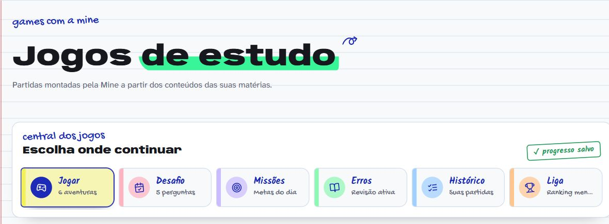

# Minerva

Plataforma educacional interativa com inteligência artificial, jogos e experiências de aprendizagem.

[Abrir demonstração ↗](https://minerva-liart.vercel.app)



## Recursos

- Assistente Mine com múltiplos provedores de IA e fallback automático.
- Jogos educacionais interativos com XP, progressão e desafios.
- Área administrativa e acompanhamento de dados.
- Interface responsiva construída com React, TypeScript e animações.
- API Node.js compatível com execução local e deploy na Vercel.

## Executar localmente

Requisitos: Node.js 20 ou superior.

```powershell
npm install
Copy-Item .env.example .env.local
npm run dev
```

Preencha apenas as variáveis necessárias em `.env.local`. Esse arquivo é ignorado pelo Git e não deve ser publicado.

## Comandos

```bash
npm test       # executa os testes automatizados
npm run build  # gera o build de produção
npm start      # inicia o servidor Node.js
```

As instruções de publicação e configuração de ambiente estão em [DEPLOY.md](DEPLOY.md).

## Tecnologias

React, TypeScript, Vite, Tailwind CSS, Framer Motion, GSAP, Three.js, Node.js e PostgreSQL.
